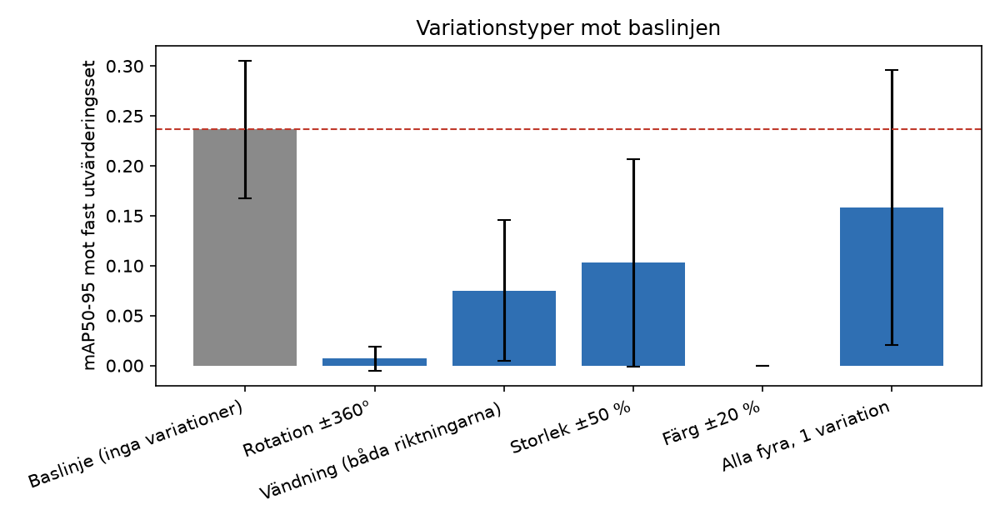
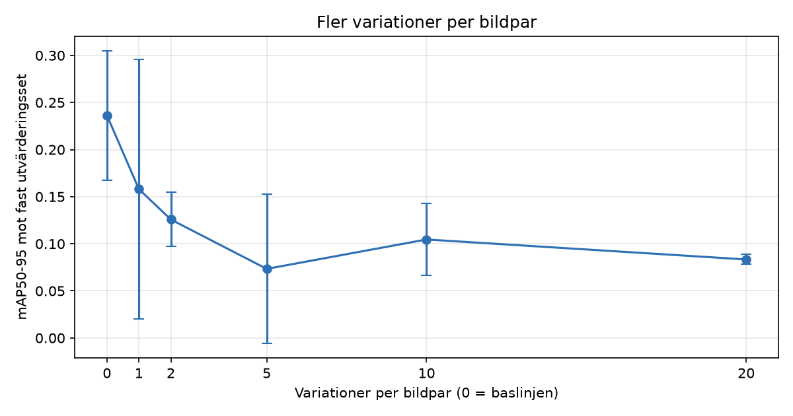
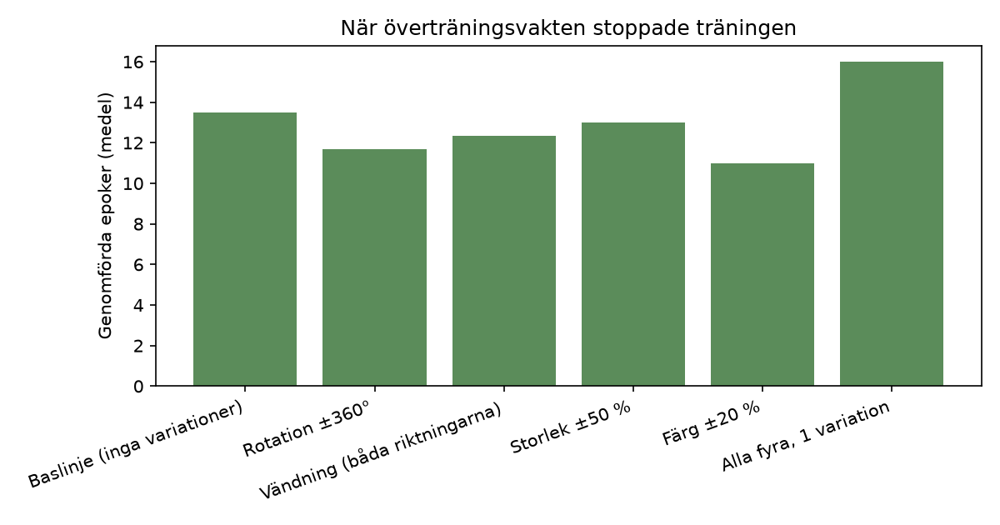

# Syntetiska bildvariationer vid ett tiotal annoterade bildpar

**Uppgift:** TASK-161 · **Basmodell:** RF-DETR large dvxray (`checkpoint_best_total.pth`) · **Epoker:** 100 · **Bildstorlek:** 800 · **Batch:** 8

Rapporten mäter hur detektionsprestandan påverkas när datasetet utökas med syntetiska bildvariationer. Alla körningar utgår från samma basmodell, samma epokantal, bildstorlek och batch, och utvärderas mot samma fasta uppsättning manuellt annoterade bildpar som aldrig ingår i träningen och aldrig utökas.

## Sammanfattning

* Med appens standardinställning, alltså överträningsvakten på, stoppade vakten varje körning efter 11–16 epoker. Baslinjen ligger på mAP50-95 0.236 och den bästa variationstypen, Alla fyra, 1 variation, på 0.158.
* Ingen variationstyp når baslinjen: den bästa ligger 0.078 under, och spridningen är 0.138.
* Ingen kombination når baslinjen heller: den bästa, 1 variation per bildpar, ger 0.158.

## Metod

### Dataset och fast utvärderingsuppsättning

Appens dataset innehåller 10 manuellt annoterade bildpar (53 objekt) och inga syntetiska bilder. Delningen är appens egen (`train_val_split` med seed 42 och 80 % till train):

| Del | Bildpar | Bilder | Objekt | Används till |
|---|---|---|---|---|
| train_base | 8 | 16 | 43 | Träning, med eller utan variationer |
| eval_fixed | 2 | 4 | 10 | Utvärdering, aldrig utökad |

Träningsdelen exporteras med appens `export_rfdetr`, som delar den i train, valid och test per bildpar. Variationerna läggs till före exporten, så alla variationer av ett bildpar hamnar i samma delmängd och aldrig läcker mellan delmängderna. Utvärderingsdelen kopieras en gång i `prepare` och rörs sedan aldrig.

### Variationerna

Styrkorna är dialogens standardvärden, alltså det en användare får när kryssrutan sätts utan att ändra något. Varje konfiguration körs med tre olika frön, eftersom `DatasetStore.add_variations` drar variationerna slumpmässigt. Appens datasetvy skickar ingen seed, så tre frön motsvarar tre olika klick på Utöka.

| Konfiguration | Typ | Antal per bildpar | Läge |
|---|---|---|---|
| Baslinje | – | 0 | – |
| Rotation | rotation ±360° | 1 | Alla valda variationer |
| Vändning | horisontell + vertikal | 1 | Alla valda variationer |
| Storlek | ±50 % | 1 | Alla valda variationer |
| Färg | kontrast och ljusstyrka ±20 % | 1 | Alla valda variationer |
| Alla fyra | alla fyra typerna | 1, 2, 5, 10, 20 | Alla valda variationer |

### Träningen

Träningen körs med appens `train_task` i en egen process, precis som träningsvyn startar den: RF-DETR large dvxray som bas, 100 epoker som tak, bildstorlek 800 och batch 8. Överträningsvakten är på, så rfdetr-paketets egen early stopping (patience 10) kan avsluta körningen i förtid. Antalet genomförda epoker redovisas per körning.

Hela matrisen utan vakt ryms inte i rimlig tid med den här basmodellen, så i stället kördes en kontroll med bara de konfigurationer som behövs för att avgöra om vakten orsakar resultaten. Den står under **Kontroll med överträningsvakten av**.

RF-DETR-exporten har också en test-del som träningen inte använder. Utvärderingen sker mot `eval_fixed`, inte mot exportens valid eller test, så den del som styr early stopping är inte samma bilder som mätningen görs på.

### Mätningen

Varje tränad modell utvärderas med appens `evaluate_run` mot `eval_fixed` med split `all`, alltså alla fyra bilderna. mAP räknas över hela precision/recall-kurvan vid konfidenströskel 0,01, och driftläget är den tröskel som ger 95 % recall. Per vy delas bilderna efter sin plats i bildparet, samma uppdelning som utvärderingsvyn visar.

Appens `falsklarm per bild` räknas bara på bilder utan objekt. Den fasta utvärderingsuppsättningen har inga sådana, så det måttet är alltid noll och redovisas som det är. Som komplement räknas **falska detektioner per bild**: de detektioner vid driftströskeln som inte matchar något facit, alltså larm som inte motsvarar ett objekt.

## Resultat med överträningsvakten på

### Körningarna

| Körning | Train (par/bilder) | Val (par/bilder) | Syntetiska par | Epoker | Stoppad av vakten | Körtid |
|---|---|---|---|---|---|---|
| baseline-r1 | 6/12 | 1/2 | 0 | 16/100 | ja | 73 s |
| baseline-r2 | 6/12 | 1/2 | 0 | 11/100 | ja | 56 s |
| rotation-s1 | 6/24 | 1/4 | 8 | 11/100 | ja | 59 s |
| rotation-s2 | 6/24 | 1/4 | 8 | 12/100 | ja | 62 s |
| rotation-s3 | 6/24 | 1/4 | 8 | 12/100 | ja | 62 s |
| flip-s1 | 6/24 | 1/4 | 8 | 11/100 | ja | 59 s |
| flip-s2 | 6/24 | 1/4 | 8 | 13/100 | ja | 65 s |
| flip-s3 | 6/24 | 1/4 | 8 | 13/100 | ja | 65 s |
| scale-s1 | 6/24 | 1/4 | 8 | 15/100 | ja | 72 s |
| scale-s2 | 6/24 | 1/4 | 8 | 13/100 | ja | 64 s |
| scale-s3 | 6/24 | 1/4 | 8 | 11/100 | ja | 57 s |
| color-s1 | 6/24 | 1/4 | 8 | 11/100 | ja | 57 s |
| color-s2 | 6/24 | 1/4 | 8 | 11/100 | ja | 56 s |
| color-s3 | 6/24 | 1/4 | 8 | 11/100 | ja | 58 s |
| all-1-s1 | 6/24 | 1/4 | 8 | 21/100 | ja | 92 s |
| all-1-s2 | 6/24 | 1/4 | 8 | 16/100 | ja | 74 s |
| all-1-s3 | 6/24 | 1/4 | 8 | 11/100 | ja | 57 s |
| all-2-s1 | 6/36 | 1/6 | 16 | 14/100 | ja | 69 s |
| all-2-s2 | 6/36 | 1/6 | 16 | 14/100 | ja | 68 s |
| all-2-s3 | 6/36 | 1/6 | 16 | 15/100 | ja | 73 s |
| all-5-s1 | 6/72 | 1/12 | 40 | 11/100 | ja | 72 s |
| all-5-s2 | 6/72 | 1/12 | 40 | 12/100 | ja | 78 s |
| all-5-s3 | 6/72 | 1/12 | 40 | 13/100 | ja | 83 s |
| all-10-s1 | 6/132 | 1/22 | 80 | 11/100 | ja | 100 s |
| all-10-s2 | 6/132 | 1/22 | 80 | 11/100 | ja | 99 s |
| all-10-s3 | 6/132 | 1/22 | 80 | 11/100 | ja | 100 s |
| all-20-s1 | 6/252 | 1/42 | 160 | 11/100 | ja | 178 s |
| all-20-s2 | 6/252 | 1/42 | 160 | 11/100 | ja | 183 s |
| all-20-s3 | 6/252 | 1/42 | 160 | 11/100 | ja | 181 s |

Train- och val-bilderna är de appens export gav efter utökningen. Val-bilderna är träningens egen valdel och används bara för early stopping och val av bästa checkpoint; mätningen sker mot `eval_fixed`.

### Variationstyper mot baslinjen

| Konfiguration | mAP50-95 | Δ mot baslinje | mAP50 | Falska detektioner/bild | Epoker |
|---|---|---|---|---|---|
| Baslinje (inga variationer) | 0.236 ± 0.069 | +0.000 | 0.714 ± 0.046 | 194.00 | 14 |
| Rotation ±360° | 0.007 ± 0.012 | -0.229 | 0.019 ± 0.033 | 15.58 | 12 |
| Vändning (båda riktningarna) | 0.075 ± 0.070 | -0.161 | 0.212 ± 0.184 | 181.50 | 12 |
| Storlek ±50 % | 0.103 ± 0.104 | -0.134 | 0.224 ± 0.217 | 106.00 | 13 |
| Färg ±20 % | 0.000 ± 0.000 | -0.236 | 0.000 ± 0.000 | 1.17 | 11 |
| Alla fyra, 1 variation | 0.158 ± 0.138 | -0.078 | 0.408 ± 0.354 | 97.75 | 16 |

Rangordning efter mAP50-95: Baslinje (inga variationer) 0.236 > Alla fyra, 1 variation 0.158 > Storlek ±50 % 0.103 > Vändning (båda riktningarna) 0.075 > Rotation ±360° 0.007 > Färg ±20 % 0.000.

Per vy, mAP50-95 (medel över upprepningarna):

| Konfiguration | vy 1 | vy 2 |
|---|---|---|
| Baslinje (inga variationer) | 0.305 | 0.226 |
| Rotation ±360° | 0.002 | 0.035 |
| Vändning (båda riktningarna) | 0.079 | 0.115 |
| Storlek ±50 % | 0.097 | 0.151 |
| Färg ±20 % | 0.000 | 0.000 |
| Alla fyra, 1 variation | 0.209 | 0.137 |

### Kombination och antal variationer per bildpar

| Konfiguration | Syntetiska par per originalpar | Train-bilder | mAP50-95 | Δ mot baslinje | mAP50 | Falska detektioner/bild | Epoker |
|---|---|---|---|---|---|---|---|
| Baslinje (inga variationer) | 0 | 12 | 0.236 ± 0.069 | +0.000 | 0.714 | 194.00 | 14 |
| Alla fyra, 1 variation | 8 | 24 | 0.158 ± 0.138 | -0.078 | 0.408 | 97.75 | 16 |
| Alla fyra, 2 variationer | 16 | 36 | 0.126 ± 0.029 | -0.111 | 0.345 | 291.08 | 14 |
| Alla fyra, 5 variationer | 40 | 72 | 0.073 ± 0.079 | -0.163 | 0.214 | 190.50 | 12 |
| Alla fyra, 10 variationer | 80 | 132 | 0.105 ± 0.038 | -0.132 | 0.276 | 290.42 | 11 |
| Alla fyra, 20 variationer | 160 | 252 | 0.083 ± 0.005 | -0.153 | 0.309 | 244.92 | 11 |

### Spridning mellan upprepningar

Baslinjen har inga variationer att dra, men dess två körningar skiljer sig ändå (0.069 i standardavvikelse): träningen är alltså inte deterministisk för den här basmodellen. Spridningen i tabellen nedan är därför en undre gräns för hur stor en skillnad mellan två konfigurationer måste vara för att betyda något.

| Konfiguration | Körningar | mAP50-95 | Std | Min–max |
|---|---|---|---|---|
| Baslinje (inga variationer) | 2 | 0.236 | 0.069 | 0.188–0.285 |
| Rotation ±360° | 3 | 0.007 | 0.012 | 0.000–0.021 |
| Vändning (båda riktningarna) | 3 | 0.075 | 0.070 | 0.000–0.139 |
| Storlek ±50 % | 3 | 0.103 | 0.104 | 0.000–0.208 |
| Färg ±20 % | 3 | 0.000 | 0.000 | 0.000–0.000 |
| Alla fyra, 1 variation | 3 | 0.158 | 0.138 | 0.000–0.254 |
| Alla fyra, 2 variationer | 3 | 0.126 | 0.029 | 0.100–0.157 |
| Alla fyra, 5 variationer | 3 | 0.073 | 0.079 | 0.000–0.157 |
| Alla fyra, 10 variationer | 3 | 0.105 | 0.038 | 0.074–0.147 |
| Alla fyra, 20 variationer | 3 | 0.083 | 0.005 | 0.078–0.089 |

### När överträningsvakten stoppade träningen

Vakten stoppade varje körning i den här matrisen. Antalet epoker skiljer sig eftersom early stopping bryter när valvärdet stått still i tio epoker, och det inträffar tidigare när datasetet är litet: med tolv träningsbilder och batch 8 är en epok bara två optimeringssteg, så tio epoker utan förbättring är tjugo steg.

## Kontroll med överträningsvakten av

Hela matrisen utan vakt skulle ta över tio timmar med RF-DETR large dvxray, eftersom varje körning då går 100 epoker. Kontrollen kör därför bara de konfigurationer som behövs för att avgöra om vakten orsakar kollapsen: baslinjen, rotation och färg, ett frön var.

| Konfiguration | mAP50-95 med vakt | Epoker | mAP50-95 utan vakt | Epoker |
|---|---|---|---|---|
| Baslinje (inga variationer) | 0.236 | 14 | 0.232 | 100 |
| Rotation ±360° | 0.007 | 12 | 0.159 | 100 |
| Färg ±20 % | 0.000 | 11 | 0.228 | 100 |

Utan vakt stiger Rotation ±360° och Färg ±20 % tydligt, alltså lärde sig modellen mer när träningen fick fortsätta. Färg ±20 % når då samma nivå som baslinjen, så kollapsen i matrisen med vakt beror helt på att träningen stoppades. Rotation ±360° återhämtar sig men når inte baslinjen, så den variationen skadar modellen även när träningen får gå 100 epoker.

## Jämförelse med YOLO-körningen

Samma matris kördes i TASK-160 med YOLO26 medium. Tabellen ställer de två basmodellerna mot varandra med överträningsvakten på, alltså appens standardinställning.

| Konfiguration | YOLO26 medium | RF-DETR large dvxray |
|---|---|---|
| Baslinje (inga variationer) | 0.002 | 0.236 |
| Rotation ±360° | 0.003 | 0.007 |
| Vändning (båda riktningarna) | 0.002 | 0.075 |
| Storlek ±50 % | 0.002 | 0.103 |
| Färg ±20 % | 0.002 | 0.000 |
| Alla fyra, 1 variation | 0.002 | 0.158 |

Baslinjen ligger på 0.236 för RF-DETR large dvxray mot 0.002 för YOLO26 medium. Den här basmodellen klarar alltså datasetet betydligt bättre redan utan variationer, vilket är väntat: den är tränad på röntgenbilder sedan tidigare.

För RF-DETR large dvxray är baslinjen 0.236 och den bästa variationstypen Alla fyra, 1 variation 0.158. Slutsatsen från TASK-160 håller: ingen variationstyp slår baslinjen.

YOLO-siffrorna i tabellen är från matrisen med vakten på, där vakten stoppade varje körning innan modellen lärt sig något; de säger alltså inget om vilken variationstyp som är bäst för YOLO26 medium. Jämförelsen som håller är att baslinjen för RF-DETR large dvxray ligger på en användbar nivå medan YOLO26 medium behöver matrisen utan vakt för att komma dit.

## Resonemang

* Med överträningsvakten på stoppade den varje körning. Med tolv träningsbilder och batch 8 blir det bara ett fåtal optimeringssteg per epok, så vaktens tio epoker utan förbättring räcker inte för att modellen ska hinna lära sig något.
* Kombinationen når inte över baslinjen heller: 5 variationer per bildpar ger 0.073 mot 0.236, trots att 72 träningsbilder ger 9 steg per epok. Fler steg räddar alltså inte resultatet.
* Färg ±20 % kollapsar helt i matrisen med vakt: alla upprepningar ger mAP50-95 0.000, och modellen larmar bara någon enstaka gång per bild. Kontrollen utan vakt visar att Färg ±20 % återhämtar sig när träningen får gå 100 epoker, så kollapsen är vaktens fel och inte variationens.
* Skillnaden mellan intilliggande steg ska jämföras med spridningen i tabellerna; ett steg som rör sig mindre än spridningen säger inget.

## Begränsningar

* Utvärderingsuppsättningen är 2 bildpar, 4 bilder och 10 objekt. Ett enda objekt flyttar mAP med ungefär en tiondel, så skillnader under ungefär 0,05 ska läsas som brus även när de är större än spridningen mellan upprepningarna.
* Träningen ser bara sex bildpar (tolv bilder) efter appens egen train/val-delning av de åtta paren. Det är den situation uppgiften beskriver, men det gör också att både baslinjen och variationerna ligger på en låg nivå.
* Utvärderingsuppsättningen saknar bilder utan objekt, så appens falsklarm per bild kan inte skilja konfigurationerna. Falska detektioner per bild är ett komplement som räknar larm som inte matchar något facit.
* Styrkorna är dialogens standardvärden. Rapporten säger inget om hur en mindre rotationsvinkel eller en svagare färgändring hade fallit ut.
* Basmodellen är RF-DETR large dvxray. En annan basmodell kan svara annorlunda på samma variationer.
* Antalet variationer per bildpar ändrar också antalet optimeringssteg per epok, eftersom träningsmängden växer. Rapporten mäter alltså utökningens samlade effekt, inte en isolerad variationseffekt vid konstant stegantal.
* Falska detektioner per bild mäts vid driftströskeln. När modellen inte lärt sig något hamnar tröskeln på 0,01 och antalet larm når detektorns tak på 300 rutor per bild, så talet ska läsas som en storleksordning och inte som ett exakt antal.

## Rekommendation

Ingen av de testade variationstyperna slår baslinjen: den bästa ligger på 0.158 mot baslinjens 0.236, och skillnaden är mindre än spridningen på 0.138. Storlek ±50 %, Vändning (båda riktningarna), Rotation ±360° och Färg ±20 % ligger dessutom under baslinjen även med spridningen inräknad, alltså sämre än att inte utöka alls. Kontrollen utan vakt visar dock att Färg ±20 % når baslinjen när träningen får gå 100 epoker, så för den variationen är det vakten och inte variationen som avgör. Vid ett tiotal bildpar är rekommendationen att träna på de manuellt annoterade bildparen som de är och lägga arbetet på fler annoterade bildpar i stället: en utökning som inte går att skilja från baslinjen kostar träningstid utan att ge något.

## Underlag

Resultatfilerna ligger i `~/.xray-detector/eval/task-160-rfdetr` och `~/.xray-detector/eval/task-160-rfdetr-kontroll` utanför repot: `results.json` med alla körningar, och `runs/<körnings-id>/` med dataset, export, träningsmanifest och modell för varje körning. Skriptet som tog fram dem är `scripts/variation_eval.py`.
