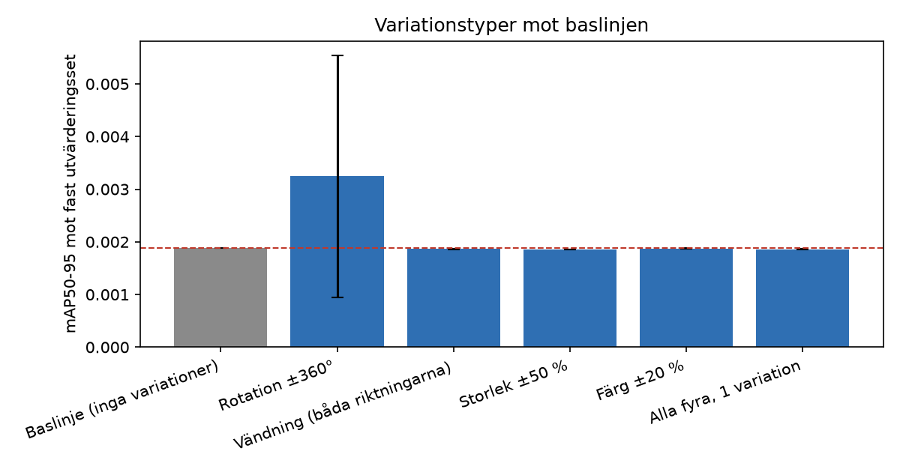
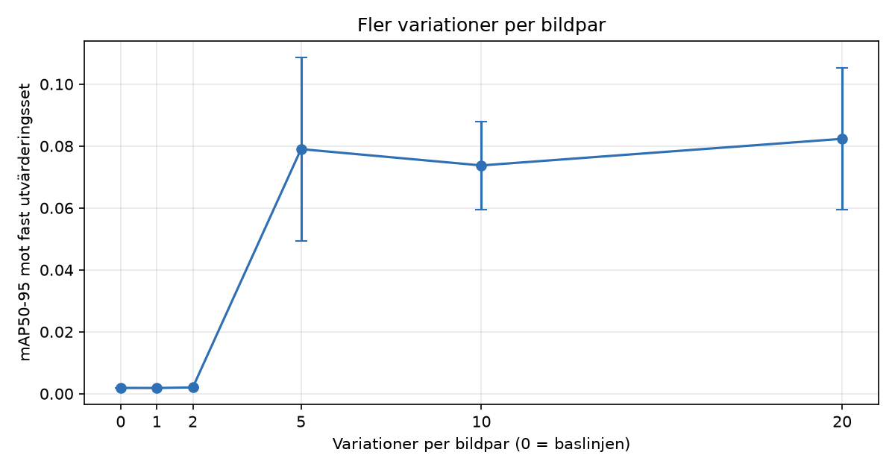
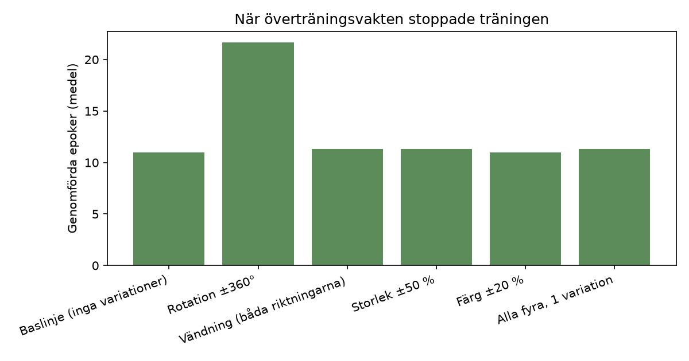
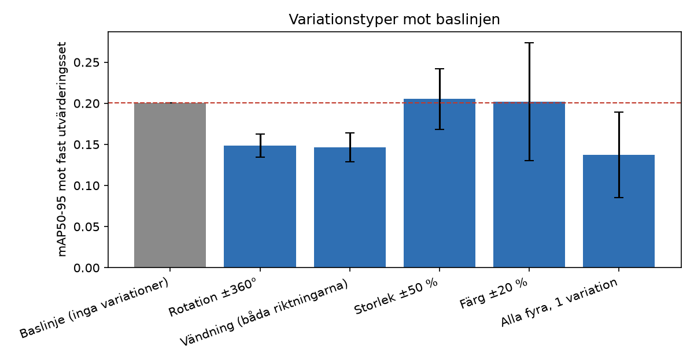
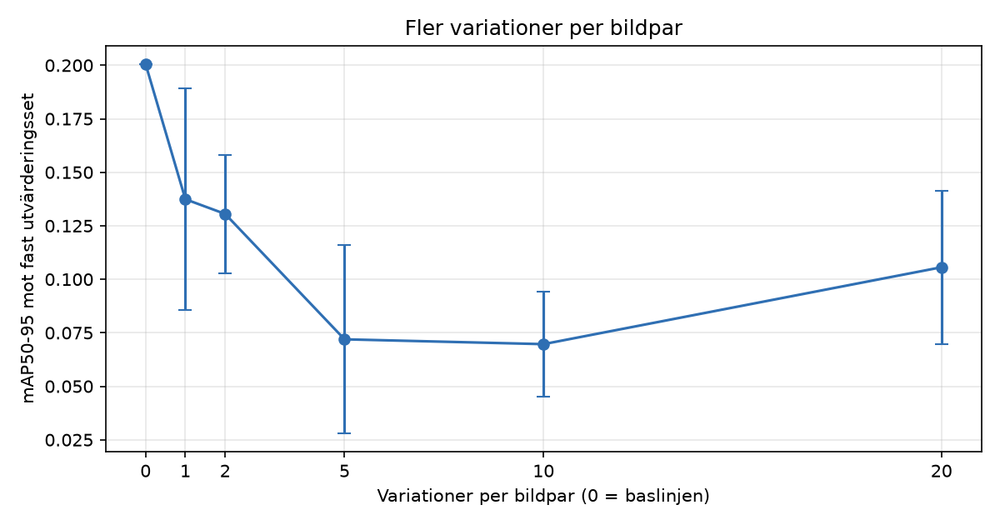

# Syntetiska bildvariationer vid ett tiotal annoterade bildpar

**Uppgift:** TASK-160 · **Basmodell:** YOLO26 medium (`yolo26m.pt`) · **Epoker:** 100 · **Bildstorlek:** 800 · **Batch:** 8

Rapporten mäter hur detektionsprestandan påverkas när datasetet utökas med syntetiska bildvariationer. Alla körningar utgår från samma basmodell, samma epokantal, bildstorlek och batch, och utvärderas mot samma fasta uppsättning manuellt annoterade bildpar som aldrig ingår i träningen och aldrig utökas.

## Sammanfattning

* Med appens standardinställning, alltså överträningsvakten på, stoppade vakten varje körning efter 11–47 epoker. Baslinjen och konfigurationerna med 0–2 variationer per bildpar landar på mAP50-95 0.002–0.003, alltså ingen skillnad som går att mäta.
* Kombinationen lyfte först vid 5 variationer per bildpar, till 0.079. Orsaken är att datasetet då blir stort nog att träningen hinner lära sig något innan vakten stoppar den, inte att variationerna i sig är bättre.
* Utan vakt, där alla körningar går 100 epoker, når ingen variationstyp över baslinjens 0.201. Storlek ±50 %, Färg ±20 % ligger på samma nivå (0.202–0.205), medan Rotation ±360°, Vändning (båda riktningarna), Alla fyra, 1 variation ligger under (0.137–0.148).
* Antalet variationer räddar inte resultatet: 1–20 variationer per bildpar ger 0.070–0.137, alltså under baslinjens 0.201 hela vägen.

## Metod

### Dataset och fast utvärderingsuppsättning

Appens dataset innehåller 10 manuellt annoterade bildpar (53 objekt) och inga syntetiska bilder. Delningen är appens egen (`train_val_split` med seed 42 och 80 % till train):

| Del | Bildpar | Bilder | Objekt | Används till |
|---|---|---|---|---|
| train_base | 8 | 16 | 43 | Träning, med eller utan variationer |
| eval_fixed | 2 | 4 | 10 | Utvärdering, aldrig utökad |

Träningsdelen exporteras med appens `export_yolo`, som delar den i train och val per bildpar. Variationerna läggs till före exporten, så alla variationer av ett bildpar hamnar i samma delmängd och aldrig läcker mellan train och val. Utvärderingsdelen kopieras en gång i `prepare` och rörs sedan aldrig.

### Variationerna

Styrkorna är dialogens standardvärden, alltså det en användare får när kryssrutan sätts utan att ändra något. Varje konfiguration körs med tre olika frön, eftersom `DatasetStore.add_variations` drar variationerna slumpmässigt. Appens datasetvy skickar ingen seed, så tre frön motsvarar tre olika klick på Utöka.

| Konfiguration | Typ | Antal per bildpar | Läge |
|---|---|---|---|
| Baslinje | – | 0 | – |
| Rotation | rotation ±360° | 1 | Alla valda variationer |
| Vändning | horisontell + vertikal | 1 | Alla valda variationer |
| Storlek | ±50 % | 1 | Alla valda variationer |
| Färg | kontrast och ljusstyrka ±20 % | 1 | Alla valda variationer |
| Alla fyra | alla fyra typerna | 1, 2, 5, 10, 20 | Alla valda variationer |

### Träningen

Träningen körs med appens `train_task` i en egen process, precis som träningsvyn startar den: YOLO26 medium som bas, 100 epoker som tak, bildstorlek 800 och batch 8. Överträningsvakten är på, så ultralytics egen early stopping (patience 10) kan avsluta körningen i förtid. Antalet genomförda epoker redovisas per körning.

Vakten visade sig avgöra hela resultatet på det här datasetet, så matrisen kördes en gång till med vakten avstängd. Den kompletterande matrisen står under **Kompletterande matris utan överträningsvakt** och är den som svarar på vilka variationer som hjälper; den första matrisen visar vad appens standardinställning gör med samma data.

### Mätningen

Varje tränad modell utvärderas med appens `evaluate_run` mot `eval_fixed` med split `all`, alltså alla fyra bilderna. mAP räknas över hela precision/recall-kurvan vid konfidenströskel 0,01, och driftläget är den tröskel som ger 95 % recall. Per vy delas bilderna efter sin plats i bildparet, samma uppdelning som utvärderingsvyn visar.

Appens `falsklarm per bild` räknas bara på bilder utan objekt. Den fasta utvärderingsuppsättningen har inga sådana, så det måttet är alltid noll och redovisas som det är. Som komplement räknas **falska detektioner per bild**: de detektioner vid driftströskeln som inte matchar något facit, alltså larm som inte motsvarar ett objekt.

## Resultat med överträningsvakten på

### Körningarna

| Körning | Train (par/bilder) | Val (par/bilder) | Syntetiska par | Epoker | Stoppad av vakten | Körtid |
|---|---|---|---|---|---|---|
| baseline-r1 | 6/12 | 2/4 | 0 | 11/100 | ja | 28 s |
| baseline-r2 | 6/12 | 2/4 | 0 | 11/100 | ja | 27 s |
| rotation-s1 | 6/24 | 2/8 | 8 | 28/100 | ja | 49 s |
| rotation-s2 | 6/24 | 2/8 | 8 | 25/100 | ja | 45 s |
| rotation-s3 | 6/24 | 2/8 | 8 | 12/100 | ja | 29 s |
| flip-s1 | 6/24 | 2/8 | 8 | 11/100 | ja | 27 s |
| flip-s2 | 6/24 | 2/8 | 8 | 11/100 | ja | 27 s |
| flip-s3 | 6/24 | 2/8 | 8 | 12/100 | ja | 28 s |
| scale-s1 | 6/24 | 2/8 | 8 | 11/100 | ja | 27 s |
| scale-s2 | 6/24 | 2/8 | 8 | 12/100 | ja | 29 s |
| scale-s3 | 6/24 | 2/8 | 8 | 11/100 | ja | 27 s |
| color-s1 | 6/24 | 2/8 | 8 | 11/100 | ja | 27 s |
| color-s2 | 6/24 | 2/8 | 8 | 11/100 | ja | 26 s |
| color-s3 | 6/24 | 2/8 | 8 | 11/100 | ja | 27 s |
| all-1-s1 | 6/24 | 2/8 | 8 | 12/100 | ja | 30 s |
| all-1-s2 | 6/24 | 2/8 | 8 | 11/100 | ja | 28 s |
| all-1-s3 | 6/24 | 2/8 | 8 | 11/100 | ja | 28 s |
| all-2-s1 | 6/36 | 2/12 | 16 | 11/100 | ja | 34 s |
| all-2-s2 | 6/36 | 2/12 | 16 | 11/100 | ja | 34 s |
| all-2-s3 | 6/36 | 2/12 | 16 | 11/100 | ja | 34 s |
| all-5-s1 | 6/72 | 2/24 | 40 | 49/100 | ja | 119 s |
| all-5-s2 | 6/72 | 2/24 | 40 | 59/100 | ja | 136 s |
| all-5-s3 | 6/72 | 2/24 | 40 | 34/100 | ja | 89 s |
| all-10-s1 | 6/132 | 2/44 | 80 | 45/100 | ja | 156 s |
| all-10-s2 | 6/132 | 2/44 | 80 | 36/100 | ja | 128 s |
| all-10-s3 | 6/132 | 2/44 | 80 | 35/100 | ja | 124 s |
| all-20-s1 | 6/252 | 2/84 | 160 | 41/100 | ja | 227 s |
| all-20-s2 | 6/252 | 2/84 | 160 | 44/100 | ja | 242 s |
| all-20-s3 | 6/252 | 2/84 | 160 | 44/100 | ja | 242 s |

Train- och val-bilderna är de appens export gav efter utökningen. Val-bilderna är träningens egen valdel och används bara för early stopping och val av bästa checkpoint; mätningen sker mot `eval_fixed`.

### Variationstyper mot baslinjen

| Konfiguration | mAP50-95 | Δ mot baslinje | mAP50 | Falska detektioner/bild | Epoker |
|---|---|---|---|---|---|
| Baslinje (inga variationer) | 0.002 ± 0.000 | +0.000 | 0.016 ± 0.000 | 298.75 | 11 |
| Rotation ±360° | 0.003 ± 0.002 | +0.001 | 0.030 ± 0.023 | 299.08 | 22 |
| Vändning (båda riktningarna) | 0.002 ± 0.000 | -0.000 | 0.016 ± 0.000 | 298.75 | 11 |
| Storlek ±50 % | 0.002 ± 0.000 | -0.000 | 0.016 ± 0.000 | 298.75 | 11 |
| Färg ±20 % | 0.002 ± 0.000 | -0.000 | 0.016 ± 0.000 | 298.75 | 11 |
| Alla fyra, 1 variation | 0.002 ± 0.000 | -0.000 | 0.016 ± 0.000 | 298.75 | 11 |

Rangordning efter mAP50-95: Rotation ±360° 0.003 > Baslinje (inga variationer) 0.002 > Färg ±20 % 0.002 > Vändning (båda riktningarna) 0.002 > Alla fyra, 1 variation 0.002 > Storlek ±50 % 0.002.

Per vy, mAP50-95 (medel över upprepningarna):

| Konfiguration | vy 1 | vy 2 |
|---|---|---|
| Baslinje (inga variationer) | 0.001 | 0.005 |
| Rotation ±360° | 0.000 | 0.007 |
| Vändning (båda riktningarna) | 0.001 | 0.005 |
| Storlek ±50 % | 0.001 | 0.005 |
| Färg ±20 % | 0.001 | 0.005 |
| Alla fyra, 1 variation | 0.001 | 0.005 |

### Kombination och antal variationer per bildpar

| Konfiguration | Syntetiska par per originalpar | Train-bilder | mAP50-95 | Δ mot baslinje | mAP50 | Falska detektioner/bild | Epoker |
|---|---|---|---|---|---|---|---|
| Baslinje (inga variationer) | 0 | 12 | 0.002 ± 0.000 | +0.000 | 0.016 | 298.75 | 11 |
| Alla fyra, 1 variation | 8 | 24 | 0.002 ± 0.000 | -0.000 | 0.016 | 298.75 | 11 |
| Alla fyra, 2 variationer | 16 | 36 | 0.002 ± 0.000 | +0.000 | 0.018 | 298.75 | 11 |
| Alla fyra, 5 variationer | 40 | 72 | 0.079 ± 0.030 | +0.077 | 0.282 | 17.17 | 47 |
| Alla fyra, 10 variationer | 80 | 132 | 0.074 ± 0.014 | +0.072 | 0.246 | 6.58 | 39 |
| Alla fyra, 20 variationer | 160 | 252 | 0.082 ± 0.023 | +0.080 | 0.261 | 4.33 | 43 |

### Spridning mellan upprepningar

Baslinjen har inga variationer att dra, så dess två körningar är identiska: träningen är deterministisk (seed 42, `deterministic=True`). Spridningen i tabellen nedan kommer därför enbart från att variationerna dras olika, och den anger hur stor en skillnad mellan två konfigurationer måste vara för att inte vara slump.

| Konfiguration | Körningar | mAP50-95 | Std | Min–max |
|---|---|---|---|---|
| Baslinje (inga variationer) | 2 | 0.002 | 0.000 | 0.002–0.002 |
| Rotation ±360° | 3 | 0.003 | 0.002 | 0.002–0.006 |
| Vändning (båda riktningarna) | 3 | 0.002 | 0.000 | 0.002–0.002 |
| Storlek ±50 % | 3 | 0.002 | 0.000 | 0.002–0.002 |
| Färg ±20 % | 3 | 0.002 | 0.000 | 0.002–0.002 |
| Alla fyra, 1 variation | 3 | 0.002 | 0.000 | 0.002–0.002 |
| Alla fyra, 2 variationer | 3 | 0.002 | 0.000 | 0.002–0.002 |
| Alla fyra, 5 variationer | 3 | 0.079 | 0.030 | 0.045–0.098 |
| Alla fyra, 10 variationer | 3 | 0.074 | 0.014 | 0.058–0.085 |
| Alla fyra, 20 variationer | 3 | 0.082 | 0.023 | 0.059–0.105 |

### När överträningsvakten stoppade träningen

Vakten stoppade varje körning i den här matrisen. Antalet epoker skiljer sig eftersom early stopping bryter när valvärdet stått still i tio epoker, och det inträffar tidigare när datasetet är litet: med tolv träningsbilder och batch 8 är en epok bara två optimeringssteg, så tio epoker utan förbättring är tjugo steg.

## Kompletterande matris utan överträningsvakt

Vakten stoppar träningen innan modellen hunnit lära sig något på det här datasetet, så den första matrisen kan inte skilja variationstyperna från varandra. Den kompletterande matrisen kör samma konfigurationer med `--overfitting-guard off`, alltså appens träning utan early stopping, så alla körningar går de 100 epokerna. Det är en avvikelse från uppgiftens genomförandemall, som säger att överträningsdetektionen ska vara aktiverad; den finns med för att frågan om variationernas effekt annars inte går att besvara. Bästa checkpoint väljs fortfarande på träningens egen valdel.

### Körningarna

| Körning | Train (par/bilder) | Val (par/bilder) | Syntetiska par | Epoker | Stoppad av vakten | Körtid |
|---|---|---|---|---|---|---|
| baseline-r1 | 6/12 | 2/4 | 0 | 100/100 | nej | 116 s |
| baseline-r2 | 6/12 | 2/4 | 0 | 100/100 | nej | 116 s |
| rotation-s1 | 6/24 | 2/8 | 8 | 100/100 | nej | 137 s |
| rotation-s2 | 6/24 | 2/8 | 8 | 100/100 | nej | 140 s |
| rotation-s3 | 6/24 | 2/8 | 8 | 100/100 | nej | 139 s |
| flip-s1 | 6/24 | 2/8 | 8 | 100/100 | nej | 131 s |
| flip-s2 | 6/24 | 2/8 | 8 | 100/100 | nej | 132 s |
| flip-s3 | 6/24 | 2/8 | 8 | 100/100 | nej | 132 s |
| scale-s1 | 6/24 | 2/8 | 8 | 100/100 | nej | 136 s |
| scale-s2 | 6/24 | 2/8 | 8 | 100/100 | nej | 131 s |
| scale-s3 | 6/24 | 2/8 | 8 | 100/100 | nej | 130 s |
| color-s1 | 6/24 | 2/8 | 8 | 100/100 | nej | 132 s |
| color-s2 | 6/24 | 2/8 | 8 | 100/100 | nej | 133 s |
| color-s3 | 6/24 | 2/8 | 8 | 100/100 | nej | 131 s |
| all-1-s1 | 6/24 | 2/8 | 8 | 100/100 | nej | 139 s |
| all-1-s2 | 6/24 | 2/8 | 8 | 100/100 | nej | 134 s |
| all-1-s3 | 6/24 | 2/8 | 8 | 100/100 | nej | 131 s |
| all-2-s1 | 6/36 | 2/12 | 16 | 100/100 | nej | 164 s |
| all-2-s2 | 6/36 | 2/12 | 16 | 100/100 | nej | 161 s |
| all-2-s3 | 6/36 | 2/12 | 16 | 100/100 | nej | 171 s |
| all-5-s1 | 6/72 | 2/24 | 40 | 100/100 | nej | 219 s |
| all-5-s2 | 6/72 | 2/24 | 40 | 100/100 | nej | 220 s |
| all-5-s3 | 6/72 | 2/24 | 40 | 100/100 | nej | 217 s |
| all-10-s1 | 6/132 | 2/44 | 80 | 100/100 | nej | 314 s |
| all-10-s2 | 6/132 | 2/44 | 80 | 100/100 | nej | 316 s |
| all-10-s3 | 6/132 | 2/44 | 80 | 100/100 | nej | 314 s |
| all-20-s1 | 6/252 | 2/84 | 160 | 100/100 | nej | 515 s |
| all-20-s2 | 6/252 | 2/84 | 160 | 100/100 | nej | 516 s |
| all-20-s3 | 6/252 | 2/84 | 160 | 100/100 | nej | 521 s |

### Variationstyper mot baslinjen

| Konfiguration | mAP50-95 | Δ mot baslinje | mAP50 | Falska detektioner/bild | Epoker |
|---|---|---|---|---|---|
| Baslinje (inga variationer) | 0.201 ± 0.000 | +0.000 | 0.650 ± 0.000 | 26.25 | 100 |
| Rotation ±360° | 0.148 ± 0.014 | -0.052 | 0.389 ± 0.083 | 17.42 | 100 |
| Vändning (båda riktningarna) | 0.147 ± 0.018 | -0.054 | 0.419 ± 0.132 | 15.08 | 100 |
| Storlek ±50 % | 0.205 ± 0.037 | +0.005 | 0.486 ± 0.084 | 14.00 | 100 |
| Färg ±20 % | 0.202 ± 0.072 | +0.001 | 0.560 ± 0.196 | 11.25 | 100 |
| Alla fyra, 1 variation | 0.137 ± 0.052 | -0.063 | 0.347 ± 0.096 | 18.50 | 100 |

Rangordning efter mAP50-95: Storlek ±50 % 0.205 > Färg ±20 % 0.202 > Baslinje (inga variationer) 0.201 > Rotation ±360° 0.148 > Vändning (båda riktningarna) 0.147 > Alla fyra, 1 variation 0.137.

Per vy, mAP50-95 (medel över upprepningarna):

| Konfiguration | vy 1 | vy 2 |
|---|---|---|
| Baslinje (inga variationer) | 0.259 | 0.200 |
| Rotation ±360° | 0.299 | 0.100 |
| Vändning (båda riktningarna) | 0.314 | 0.115 |
| Storlek ±50 % | 0.397 | 0.143 |
| Färg ±20 % | 0.322 | 0.162 |
| Alla fyra, 1 variation | 0.246 | 0.102 |

### Antal variationer per bildpar

| Konfiguration | Syntetiska par per originalpar | Train-bilder | mAP50-95 | Δ mot baslinje | mAP50 | Falska detektioner/bild | Epoker |
|---|---|---|---|---|---|---|---|
| Baslinje (inga variationer) | 0 | 12 | 0.201 ± 0.000 | +0.000 | 0.650 | 26.25 | 100 |
| Alla fyra, 1 variation | 8 | 24 | 0.137 ± 0.052 | -0.063 | 0.347 | 18.50 | 100 |
| Alla fyra, 2 variationer | 16 | 36 | 0.131 ± 0.028 | -0.070 | 0.418 | 12.67 | 100 |
| Alla fyra, 5 variationer | 40 | 72 | 0.072 ± 0.044 | -0.129 | 0.203 | 6.00 | 100 |
| Alla fyra, 10 variationer | 80 | 132 | 0.070 ± 0.025 | -0.131 | 0.223 | 4.50 | 100 |
| Alla fyra, 20 variationer | 160 | 252 | 0.106 ± 0.036 | -0.095 | 0.344 | 2.75 | 100 |

### Spridning mellan upprepningar

| Konfiguration | Körningar | mAP50-95 | Std | Min–max |
|---|---|---|---|---|
| Baslinje (inga variationer) | 2 | 0.201 | 0.000 | 0.201–0.201 |
| Rotation ±360° | 3 | 0.148 | 0.014 | 0.134–0.161 |
| Vändning (båda riktningarna) | 3 | 0.147 | 0.018 | 0.127–0.159 |
| Storlek ±50 % | 3 | 0.205 | 0.037 | 0.178–0.247 |
| Färg ±20 % | 3 | 0.202 | 0.072 | 0.131–0.275 |
| Alla fyra, 1 variation | 3 | 0.137 | 0.052 | 0.105–0.197 |
| Alla fyra, 2 variationer | 3 | 0.131 | 0.028 | 0.101–0.155 |
| Alla fyra, 5 variationer | 3 | 0.072 | 0.044 | 0.023–0.108 |
| Alla fyra, 10 variationer | 3 | 0.070 | 0.025 | 0.041–0.085 |
| Alla fyra, 20 variationer | 3 | 0.106 | 0.036 | 0.077–0.146 |

## Resonemang

* Med överträningsvakten på stoppade den varje körning. Med tolv träningsbilder och batch 8 är en epok två optimeringssteg, så vaktens tio epoker utan förbättring är tjugo steg. Modellen behöver omkring hundra steg innan valvärdet rör sig, så vakten hinner stoppa träningen innan den börjat lära sig. Det syns på att alla enskilda variationstyper hamnar på samma mAP som baslinjen.
* Kombinationen lyfte först vid 5 variationer per bildpar, där 72 träningsbilder ger 9 steg per epok. Då räcker vaktens tio epoker tillräckligt många steg för att valvärdet ska röra sig, och träningen får fortsätta. Att kurvan planar ut vid 10 och 20 variationer beror på att stegantalet redan är tillräckligt där.
* Utan vakt går alla körningar 100 epoker, och då går typerna att jämföra. Varje typ har samma antal träningsbilder som de andra, så skillnaden mellan dem är en skillnad i variationen och inte i stegantal.
* **Rotation ±360°** ger -0.052 mAP50-95 mot baslinjen utan vakt och ligger under baslinjen även med spridningen inräknad (spridning 0.014).
* **Vändning (båda riktningarna)** ger -0.054 mAP50-95 mot baslinjen utan vakt och ligger under baslinjen även med spridningen inräknad (spridning 0.018).
* **Storlek ±50 %** ger +0.005 mAP50-95 mot baslinjen utan vakt och går inte att skilja från baslinjen (spridning 0.037).
* **Färg ±20 %** ger +0.001 mAP50-95 mot baslinjen utan vakt och går inte att skilja från baslinjen (spridning 0.072).
* **Alla fyra, 1 variation** ger -0.063 mAP50-95 mot baslinjen utan vakt och ligger under baslinjen även med spridningen inräknad (spridning 0.052).
* Ingen av kombinationerna når baslinjen: den bästa, 1 variation per bildpar, ger 0.137 mot baslinjens 0.201. Fler variationer räddar alltså inte ett resultat som en enda variation försämrar.
* Ingen övre gräns kunde fastställas: kurvan når aldrig baslinjen inom det testade intervallet 1–20 variationer per bildpar, så det finns ingen nivå där fler variationer slutar förbättra. De förbättrar aldrig, och efter 10 variationer vänder kurvan svagt uppåt igen utan att komma i närheten.
* Per vy syns ett mönster som gäller alla typer: de höjer mAP på vy 1 men sänker den på vy 2. Bildparet är samma scen från två håll, och en speglad, roterad eller skalad bild är ingen bild som kamerorna kan producera. En rimlig förklaring är att modellen lär sig kännetecken som bara finns i de syntetiska bilderna och tappar den vy där originalen är svårast, men rapporten mäter inte orsaken.
* Skillnaden mellan intilliggande steg ska jämföras med spridningen i tabellerna; ett steg som rör sig mindre än spridningen säger inget.

## Begränsningar

* Utvärderingsuppsättningen är 2 bildpar, 4 bilder och 10 objekt. Ett enda objekt flyttar mAP med ungefär en tiondel, så skillnader under ungefär 0,05 ska läsas som brus även när de är större än spridningen mellan upprepningarna.
* Träningen ser bara sex bildpar (tolv bilder) efter appens egen train/val-delning av de åtta paren. Det är den situation uppgiften beskriver, men det gör också att både baslinjen och variationerna ligger på en låg nivå.
* Utvärderingsuppsättningen saknar bilder utan objekt, så appens falsklarm per bild kan inte skilja konfigurationerna. Falska detektioner per bild är ett komplement som räknar larm som inte matchar något facit.
* Styrkorna är dialogens standardvärden. Rapporten säger inget om hur en mindre rotationsvinkel eller en svagare färgändring hade fallit ut.
* Basmodellen är appens standardmodell, YOLO26 medium. En modell som redan är tränad på röntgenbilder kan svara annorlunda på samma variationer.
* Antalet variationer per bildpar ändrar också antalet optimeringssteg per epok, eftersom träningsmängden växer. Rapporten mäter alltså utökningens samlade effekt, inte en isolerad variationseffekt vid konstant stegantal.
* Falska detektioner per bild mäts vid driftströskeln. När modellen inte lärt sig något hamnar tröskeln på 0,01 och antalet larm når detektorns tak på 300 rutor per bild, så talet ska läsas som en storleksordning och inte som ett exakt antal.

## Rekommendation

Ingen av de testade variationstyperna höjer mAP50-95 mer än spridningen mellan upprepningarna. Rotation ±360°, Vändning (båda riktningarna), Alla fyra, 1 variation ligger dessutom under baslinjen även med spridningen inräknad, alltså sämre än att inte utöka alls. Vid ett tiotal bildpar är rekommendationen att träna på de manuellt annoterade bildparen som de är och lägga arbetet på fler annoterade bildpar i stället: en utökning som inte går att skilja från baslinjen kostar träningstid utan att ge något.

## Underlag

Resultatfilerna ligger i `~/.xray-detector/eval/task-160` och `~/.xray-detector/eval/task-160-noguard` utanför repot: `results.json` med alla körningar, och `runs/<körnings-id>/` med dataset, export, träningsmanifest och modell för varje körning. Skriptet som tog fram dem är `scripts/variation_eval.py`.
