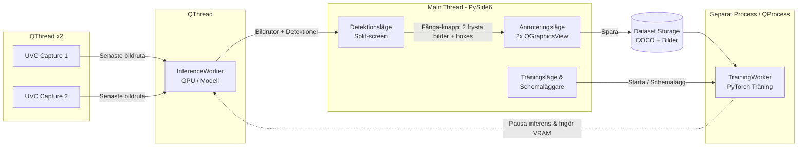

# Implementationsplan – X-ray Detector

Denna plan beskriver arkitektur, teknologival, datamodeller och genomförandesteg för att implementera **X-ray Detector** på Windows 11 enligt kraven i `specs.md`.

---

## 1. Teknologival & Plattform

För att uppnå hög prestanda utan väntetider i GUI, smidig hantering av två USB 3.0 UVC-videoströmmar och flexibel integration med moderna detektionsmodeller (YOLO26, RF-DETR m.fl.) föreslås följande teknikstack i Python:

* **GUI-ramverk:** **PySide6 (Qt for Python)**
  * *Motivering:* Har inbyggt stöd för hårdvaruaccelererad rendering, fullskärms-/kioskläge, trådning (`QThread`, Signals & Slots) samt `QGraphicsView`/`QGraphicsScene` som är idealiskt för interaktiv ritning och storleksändring av rektanglar (bounding boxes) med musen.
* **Videofångst:** **OpenCV (`cv2.VideoCapture`) med DirectShow (`CAP_DSHOW`) eller Media Foundation (`CAP_MSMF`)**
  * *Motivering:* Stabilt stöd i Windows 11 för UVC-kort över USB 3.0 med möjlighet att sätta upplösning, FPS och buffertstorlek (`CAP_PROP_BUFFERSIZE = 1`) för minimal latens.
* **AI / Detektion & Träning:** **PyTorch + Ultralytics (YOLO) + RF-DETR (`rfdetr` / `transformers`)**
  * *Motivering:* Kapslas in bakom ett gemensamt abstrakt gränssnitt (`BaseDetector` / `BaseTrainer`) så att GUI och bildpipeline är oberoende av vilken modellarkitektur som körs.
* **Pakethantering & Miljö:** `uv` eller `venv` med `pyproject.toml` och låsta beroenden (inklusive CUDA-aktiverad PyTorch för Windows 11).

---

## 2. Beslut kring Datasetformat (COCO vs. YOLO)

> **Fråga i `specs.md`:** *"Dataset ska kunna exporteras till COCO alt YOLO format (eller är det bäst att alltid jobba i t ex COCO format så att export inte behövs?)"*

### Rekommendation: Använd COCO JSON som internt kanoniskt format + automatisk generering av YOLO-format vid behov
1. **Varför COCO som huvudformat?**
   * **RF-DETR** och de flesta moderna transformer-baserade detektorer använder **COCO-format** direkt vid träning.
   * COCO JSON stöder rik metadata direkt i filen (`info`-blocket: `version`, `date_created`, `description`, antal bilder och annoteringar), vilket direkt uppfyller kravet på att versionssiffra, datum och antal bildobjekt ska framgå.
   * Det är enkelt att lägga till nya klasser dynamiskt utan att behöva skriva om hundratals separata `.txt`-filer.
2. **Hur hanteras YOLO-formatet?**
   * Eftersom YOLO kräver en `data.yaml` och en `.txt`-fil per bild med normaliserade koordinater (`class_id x_center y_center width height`), genereras dessa **automatiskt vid export eller precis när en YOLO-träning startas** utifrån COCO-filen.
   * **Fördel:** Användaren slipper manuell konvertering i vardagen (allt sparas direkt i ett versionshanterat strukturformat), samtidigt som en explicit "Exportera / Frys Dataset-version (COCO + YOLO)"-funktion skapar en låst, reproducerbar snapshot (`v1`, `v2`, ...) med både COCO JSON och YOLO-struktur.

---

## 3. Systemarkitektur & Trådningsmodell (Prestanda)

För att garantera att applikationen aldrig fryser eller upplevs långsam för användaren separeras I/O, inferens, träning och GUI i olika trådar/processer:



1. **Kameratrådar (`CameraWorker` x 2):**
   * Läser kontinuerligt bildrutor från respektive UVC-enhet i varsin tråd. Håller alltid endast den **senaste** bildrutan i en trådsäker buffert så att ingen köbildning/fördröjning uppstår.
2. **Inferenstråd (`InferenceWorker`):**
   * Hämtar det senaste bildparet (Ström 1 & Ström 2), kör dem genom vald detektionsmodell (antingen som en batch om 2 bilder eller sekventiellt på GPU) och skickar resultatet (`FrameResult`: bild + lista med `[x1, y1, x2, y2, class_id, class_name, confidence]`) till GUI via Qt-signaler.
3. **Träningsprocess (`TrainingManager` + `subprocess`/`multiprocessing`):**
   * Träning körs i en **separat Python-process** för att undvika att Python GIL (Global Interpreter Lock) eller PyTorch CUDA-allokeringar påverkar GUI:ts responsivitet.
   * **Resursoptimering:** När träning startar pausas `InferenceWorker` automatiskt och modellen lastas ur GPU-minnet (`torch.cuda.empty_cache()`) för att ge träningen 100 % av tillgänglig VRAM. När träningen är klar (eller avbryts) laddas detektionsmodellen in igen.
   * **Schemaläggning & Inaktivitet:** En `SchedulerService` övervakar klockslag (t.ex. nattetid 01:00–05:00) eller användarinaktivitet och kan starta köade träningsjobb automatiskt.

---

## 4. Funktionell Specifikation per Vy

### 4.1 Huvudfönster & Kioskläge (`MainWindow`)
* Startar som standard i **Detektionsläge** och kan köras i **Fullscreen / Kioskläge** (styrs via konfigurationsfil samt kortkommando `F11` / knapp i UI).
* En diskret verktygsrad högst upp (eller längst ner) visar:
  * Aktuellt läge (*Detektion*, *Annotering*, *Träning*)
  * Aktiv modell och dess versionsnummer (t.ex. `YOLO26 - v3`)
  * Status för kameraströmmar (FPS, anslutningsstatus) och eventuell schemalagd träning.

### 4.2 Detektionsläge (`DetectionView`) – Default
* **Split-screen:** Visar Ström 1 (vänster) och Ström 2 (höger) sida vid sida med bibehållen bildproportion.
* **Overlay:** Ritar rektanglar (bounding boxes) med färgkodning per klass samt etikett med `Klassnamn (XX%)`.
* **Fånga-knapp (`Fånga / Annotera` + kortkommando t.ex. `Space`):**
  1. Fryser omedelbart aktuell råbild (utan inritad grafik) från Ström 1 och Ström 2.
  2. Kopierar de aktuella detektionerna (koordinater + predikterade klasser) från exakt dessa två bildrutor.
  3. Växlar vy till **Annoteringsläge** och laddar in bilderna samt detektionerna.

### 4.3 Annoteringsläge (`AnnotationView`)
* **Två interaktiva ritvyer (`AnnotationCanvas` baserad på `QGraphicsView`):**
  * Visar de två frysta bilderna sida vid sida.
  * Alla befintliga detektioner från fångsttillfället läggs automatiskt in som redigerbara rektangelobjekt (`EditableBoxItem`).
* **Interaktion med rektanglar (`EditableBoxItem`):**
  * **Skapa ny:** Klicka och dra på fri yta i någon av bilderna för att rita en ny rektangel.
  * **Storleksändra:** Varje rektangel har 8 greppunkter (4 hörn + 4 kanter). Att trycka och dra i ett hörn eller en kant ändrar rektangelns storlek med visuell kursiv/pil-indikering.
  * **Flytta / Ta bort:** Dra inuti rektangeln för att flytta den, eller tryck `Delete` / papperskorgsikon för att ta bort en felaktig detektion.
* **Klasshantering:**
  * Vid sidan av (eller ovanför) vyerna finns en klasspanel samt en popup/dropdown kopplad till den markerade rektangeln.
  * Användaren kan **byta klass** på en markerad rektangel genom att välja från en befintlig lista.
  * Användaren kan **skriva in en helt ny klass** i ett textfält ("+ Ny klass"), vilket direkt lägger till klassen i projektets klasslista och tilldelar den till det markerade objektet.
* **Spara & Dataset-versionshantering:**
  * **Spara-knapp:** Sparar de två bilderna till arbetsdatasetet (`data/working/images/`), uppdaterar annoteringarna och **återgår direkt till Detektionsläget**.
  * **Skapa / Exportera Dataset-version:** I gränssnittet kan man när som helst låsa/exportera en ny dataset-version (eller så skapas en ny version automatiskt inför träning). Varje version lagras under `data/datasets/v{X}_{YYYY-MM-DD}/` med:
    * `manifest.json` & `annotations.coco.json` (innehåller **versionssiffra**, **datum**, **antal bilder** och **totalt antal annoterade bildobjekt** samt uppdelning per klass).
    * Valbar/automatisk export till **YOLO-format** (`images/`, `labels/`, `data.yaml`) och **COCO-format**.

### 4.4 Träningsläge (`TrainingView`)
* **Konfiguration av träningskörning:**
  * **Basmodell:** Välj modellfamilj och startvikter (t.ex. *YOLO26 (förtränad/bas)*, *RF-DETR (bas)*, eller fortsätt träna från en tidigare egen modellversion).
  * **Dataset:** Välj vilken dataset-version som ska nyttjas (visar versionssiffra, datum, antal bilder och antal objekt i listan).
  * **Träningsparametrar:** Epoker (`epochs`), batch-storlek (`batch_size`), bildupplösning (`imgsz`), inlärningshastighet (`lr`), samt val av train/val-split (t.ex. 80/20).
* **Exekveringsval:**
  * **Starta nu:** Pausar detektionsläget, frigör GPU-minne och startar träningen direkt med realtidsgraf för loss/mAP och loggutskrift.
  * **Schemalägg (Nattetid / Inaktivitet):** Lägger träningsjobbet i kö så att det startar automatiskt vid angiven tid (t.ex. kl. 22:00) eller efter X minuters inaktivitet, och återupptar detektionsläget när träningen är klar.
* **Versionshantering av modellvikter:**
  * Efter avslutad träning sparas modellvikterna automatiskt i `models/v{DatasetVersion}_{ModelArch}_{Datum}/` (t.ex. `models/v4_yolo26_2026-11-03/best.pt`) tillsammans med en `model_meta.json` som kopplar modellen till **samma versionssiffra som det dataset som använts**.

---

## 5. Föreslagen Projektstruktur

```text
xray-detector/
├── pyproject.toml                 # Beroenden och projektkonfiguration
├── config.yaml                    # Kamera-ID:n, sökvägar, standardmodell, kiosk-inställningar
├── main.py                        # Startpunkt för applikationen
├── src/
│   ├── app.py                     # Initiering av QApplication och tjänster
│   ├── core/
│   │   ├── config.py              # Läsning/skrivning av konfiguration
│   │   ├── models_schema.py       # Dataklasser: Detection, FramePair, DatasetVersion, TrainingJob
│   │   └── scheduler.py           # Schemaläggning (nattetid / inaktivitet)
│   ├── video/
│   │   ├── camera_worker.py       # QThread för UVC-videoström (USB 3.0)
│   │   └── stream_manager.py      # Hanterar båda kameraströmmarna och synkron bildfångst
│   ├── ml/
│   │   ├── base.py                # Abstrakta gränssnitt: BaseDetector, BaseTrainer
│   │   ├── yolo_backend.py        # YOLO26-inferens och träning
│   │   ├── rfdetr_backend.py      # RF-DETR-inferens och träning
│   │   ├── inference_worker.py    # QThread för realtidsdetektion på båda strömmarna
│   │   └── training_worker.py     # QProcess / separat process för modellträning
│   ├── dataset/
│   │   ├── dataset_manager.py     # Hanterar working-dataset, klasser, versionsfrysning
│   │   └── exporters.py           # Konvertering & export till COCO JSON och YOLO-format
│   └── ui/
│       ├── main_window.py         # Huvudfönster, navigering, fullscreen/kioskläge
│       ├── detection_view.py      # Split-screen videovy + Fånga-knapp
│       ├── annotation_view.py     # Annoteringsvy med klasslista, spara & datasetexport
│       ├── annotation_canvas.py   # QGraphicsView + ResizableBoxItem (hörn/kant-dragning)
│       └── training_view.py       # Träningsinställningar, schemaläggning & loggvy
├── data/
│   ├── working/                   # Pågående insamlade bilder och annoteringar
│   └── datasets/                  # Låsta/exporterade dataset-versioner (v1, v2, ...)
└── models/
    ├── base/                      # Nedladdade basmodeller (YOLO26, RF-DETR)
    └── trained/                   # Färdigtränade modeller med datasetets versionssiffra
```

---

## 6. Implementationsfaser (Steg-för-steg)

### Fas 1: Projektgrund, Datamodeller & Kamera-pipeline
1. Sätt upp `pyproject.toml`, mappstruktur och `config.yaml`.
2. Implementera `CameraWorker` och `StreamManager` för två UVC-strömmar (inklusive fallback till testvideofiler/syntetiska strömmar under utveckling om fysiska kameror inte är inkopplade).
3. Bygg `MainWindow` med stöd för kioskläge/fullscreen och vyväxling (`QStackedWidget`).

### Fas 2: Detektionsläge & Modellabstraktion
1. Implementera `BaseDetector` samt adaptrar för **YOLO** och **RF-DETR**.
2. Implementera `InferenceWorker` som tar bildrutor från båda kameraströmmarna och returnerar detektioner utan att blockera GUI.
3. Bygg `DetectionView` med split-screen, ritning av rektanglar/klasser/sannolikheter samt **Fånga**-knappen som fryser bildparet och dess detektioner.

### Fas 3: Annoteringsläge & Interaktiv Canvas
1. Implementera `AnnotationCanvas` (`QGraphicsView`) och `ResizableBoxItem` (`QGraphicsRectItem` med 8 interaktiva handtag i hörn och kanter för storleksändring samt stöd för att rita nya rektanglar).
2. Koppla så att befintliga detektioner från fångstögonblicket automatiskt ritas in och kan redigeras.
3. Bygg klassväljaren (välj befintlig klass från lista eller skriv in en ny klass) och koppla "Spara"-knappen så att bilderna + annoteringarna sparas och användaren återgår till Detektionsläget.

### Fas 4: Dataset-hantering & Export (COCO / YOLO)
1. Implementera `DatasetManager` som lagrar annoteringar i kanoniskt COCO-format och håller reda på klasser.
2. Implementera versionshantering och export (`exporters.py`) till både **COCO** och **YOLO** där varje version/export tydligt dokumenterar **versionssiffra, datum och antal bildobjekt**.

### Fas 5: Träningsläge, Modellversionering & Schemaläggning
1. Implementera `BaseTrainer` för YOLO och RF-DETR i en separat process (`TrainingWorker`).
2. Bygg `TrainingView` där användaren väljer basmodell, dataset-version och träningsparametrar.
3. Implementera automatisk pausning av `InferenceWorker` under pågående träning samt schemaläggning (nattetid / vid inaktivitet).
4. Säkerställ att sparade modellvikter får exakt samma versionssiffra som det använda datasetet och direkt blir valbara i Detektionsläget.

### Fas 6: Testning, Optimering & Verifiering
1. Enhetstester för koordinatkonvertering (skärm <-> bild <-> COCO <-> YOLO) och dataset-versionering.
2. Prestandatest med dubbla 1080p/60fps UVC-strömmar för att verifiera laggfri GUI-upplevelse.
